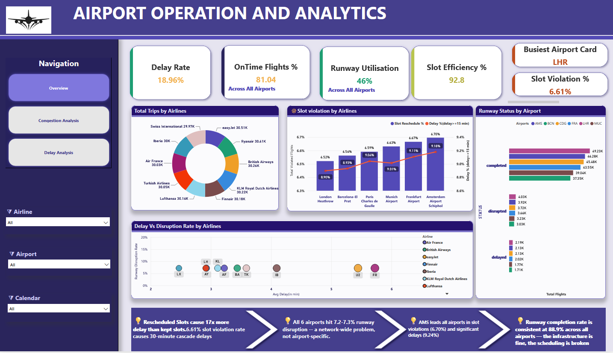
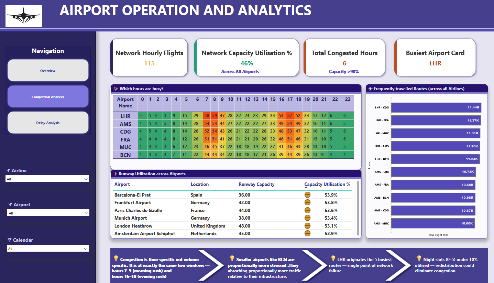
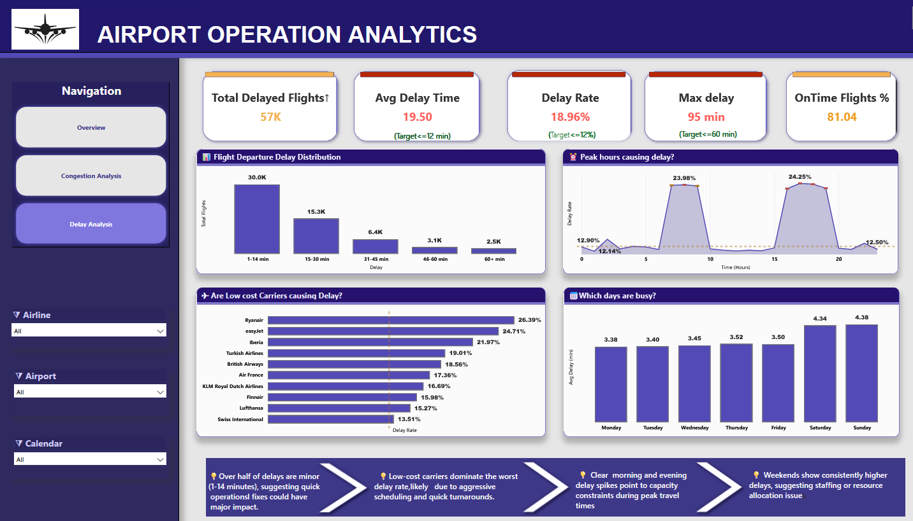

# ✈️ Airport Operation Analytics

### Power BI | Snowflake | SQL | DAX | Data Modelling

An aviation analytics project focused on understanding **airport congestion, runway capacity, flight delays, slot utilization, and operational performance** across major European airports.

The project transforms large-scale flight movement data into actionable business insights using **Snowflake, SQL, Power BI, and DAX**.

---

## 🎯 Business Objective

The objective of this project is to identify key operational challenges and answer questions such as:

- Which airports experience the highest congestion?
- When does runway capacity come under pressure?
- How do slot rescheduling and utilization affect delays?
- Which airlines experience higher disruption rates?
- What are the key operational bottlenecks?

---

## 📊 Project Scope

The analysis covers:

- **3M+ flight movements**
- **6 European airport hubs**
- **10 airlines**
- **91 days of operations**

---

## 🛠️ Tools & Technologies

- **Power BI** – Dashboard and data visualization
- **Snowflake** – Cloud data platform
- **SQL** – Data transformation and analysis
- **DAX** – KPI and analytical calculations
- **Data Modelling** – Structured analytical model and dataset integration

---

## 📈 Dashboard Analysis

The Power BI dashboard provides insights into:

- ✈️ Airport Congestion
- 🛫 Runway Capacity
- ⏱️ Flight Delays
- 🎯 Slot Utilization
- 🏢 Airline Performance
- 🚦 Operational Bottlenecks

---

## 🔍 Key Insights

- **81% on-time performance** was observed in the case study, below the cited 88% EU regulatory threshold.
- Significant runway capacity pressure was identified around **08:00 and 17:00**.
- **Rescheduled slots** were associated with substantially higher delays compared with kept slots.
- Differences in disruption rates were observed across airlines.
- Approximately **7.2% runway disruption** was reported across the airports.

---

## 💡 Business Value

The analysis demonstrates how aviation operational data can be used to identify **capacity constraints, scheduling issues, delay drivers, and operational bottlenecks**, supporting more informed airport and airline decision-making.

---

## 📸 Dashboard Preview
<p></p>
<p></p>



```text
🏷️ Topics

Power BI SQL Snowflake DAX Data Analytics Business Intelligence Data Modelling Aviation Analytics Dashboard
